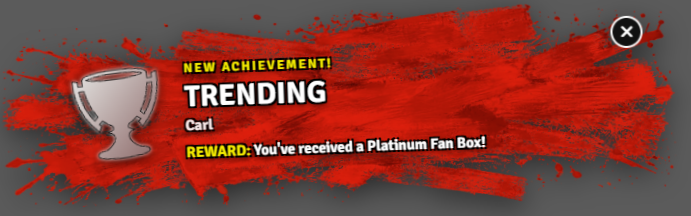
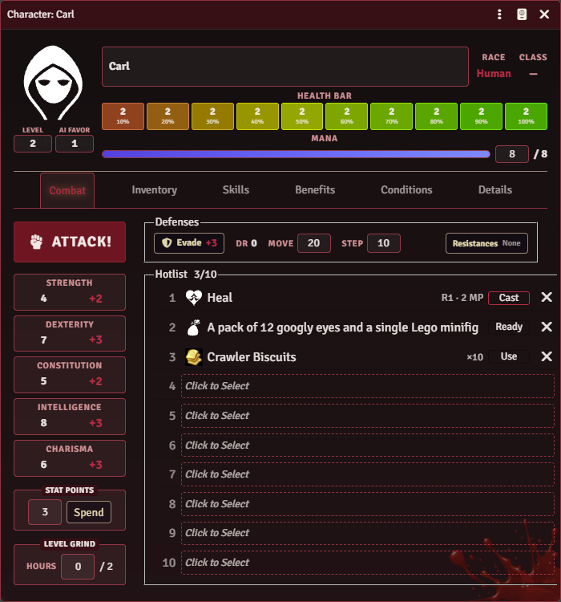
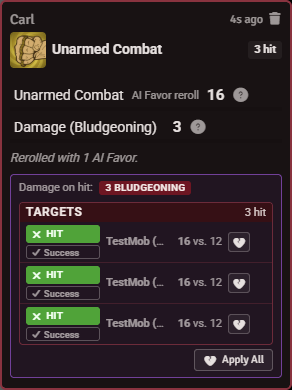
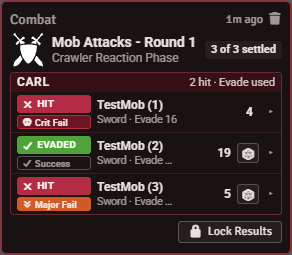
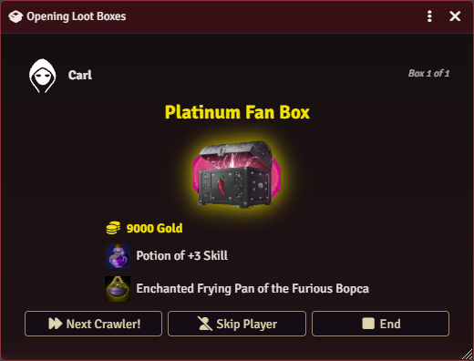

# Dungeon Crawler Carl RPG


An unofficial Foundry VTT system implementing the tabletop RPG rules for
_Dungeon Crawler Carl_.

This is a fan project, not affiliated with or endorsed by Matt Dinniman or
the rulebook's publisher, Renegade Game Studios. Use at your own risk.

**New to the system? See the [wiki](https://github.com/SobranDM/carl-rpg/wiki)**
for how everything works, from making a crawler to opening loot boxes.



## Features

### Characters

- A Character sheet with Combat, Inventory, Skills, Benefits, Conditions and
  Details tabs, an Equipment Doll and a Hotlist
- A Create Crawler wizard for First Floor characters, animal crawlers included
- Pets and vehicles as their own actors
- Bonuses from Races, Classes, gear, Skills and Spells applied for you,
  including DR, Move, Evade and armor by slot
- Potions, scrolls and spellbooks you can use, with Potion Sickness tracked
- Races that change with day and night, such as the Lajabless and Night
  Elves, from a sun/moon toggle in the GM Toolbox

<p align="center">
  
</p>

### Rolls and combat

- Skill, Stat, Attack, Heal and Evade rolls. The roll dialog fills in the
  book's Difficulty, and the chat cards apply damage and healing on a click
- Opposed Checks against a targeted creature, any creature on the scene, or
  a number such as a Spell Rank
- Phased combat (Declaration, Reaction, Resolution, Crawler Actions) with
  Action tracking, Intervene, Shield Block and Taunt
- One Evade covers every Attack aimed at you that round, and every row on an
  Attack, Reaction or Damage card shows its Degree of success
- Damage through DR, Resistance, Vulnerability and Immunity into whole
  Health Bar slots, with Shields as a second pool
- Debuffs that apply their penalties, change Mob Difficulties, and wear off
  on their own
- Mob sheets whose Attacks carry their to-hit, damage and Debuffs

<p align="center">
  
  
</p>

### Loot and achievements

- Achievements, made and awarded from the GM Toolbox. The crawler's player
  gets a splash for each one, and the GM can group them into categories
- Loot boxes in the Inventory, from achievements, Boss kills or the GM. The
  party opens them together, one crawler at a time, with everyone watching
- Box contents rolled from Roll Tables for each tier, or prepared ahead of
  time by the GM for each crawler. Magic items are rolled on the book's
  tables and come with working bonuses
- Themed boxes, such as Goblin, Pet and Crafter's boxes, draw from their own
  tables
- GMs can swap in their own copies of the box tables, and of the character
  creation tables

<p align="center">
  
</p>

### GM Toolbox

- Rests, Mending, End Floor and Boss Killed, and Party Skill Checks
- Grinding for several crawlers at once, toward their Skills and their next
  Level. The lowest Level grinding gains 1d2 Levels, as the book says
- A floor collapse timer on everyone's screen, in 30-hour days. It follows
  Foundry's in-world clock, so rests, grinding and combat move it
- A real-world session timer for the two-hour tick
- Day or night in the dungeon, for the Races and Mobs that change with it

### Compendiums

- Skills, Spells, Damage Effects, Classes and Races
- Gear, consumables, and Roll Tables for loot

## Importing your rulebooks

This system does not ship any rulebook text or art. If you own the PDFs, a GM
can import them from the system's settings, under **Import Rulebook PDF**:

- **Gear and Spells.** Where this system's compendiums already have the item,
  that copy is used.
- **Mobs,** with their Attacks and Debuffs, filed by Floor and then by
  Neighborhood or Quest.
- **Achievements,** into the Achievements compendium, in a folder per book.
- **Maps** as gridless Scenes. Map images are saved to
  `carl-rpg/<book>/maps/` in your Foundry Data folder.

Each book gets its own GM-only compendiums. Importing a book again updates
what you haven't edited and leaves your changes alone. The low-quality (LQ)
edition of the PDF isn't supported.

Characters made on CrawlerForge can be brought in with the **Import
CrawlerForge** button in the Actors sidebar.

See [Importing](https://github.com/SobranDM/carl-rpg/wiki/Importing) on the
wiki for more.

## Installation

In Foundry's Game Systems tab, install via manifest URL:

```
https://github.com/SobranDM/carl-rpg/releases/latest/download/system.json
```

## Development

```
npm install
npm run build          # compile Sass -> css/carl-rpg.css
npm run build:packs    # compile packs-source/*.json -> the LevelDB packs Foundry reads
npm run unpack:packs   # the reverse - pull in-world compendium edits back into packs-source/
npm run format         # format the code (oxfmt); format:check only reports
npm run check:packs    # every compendium link in packs-source/ points at a real document
npm run check:tooltips # tooltips use Foundry's tooltip attributes, not HTML titles
```

`build:packs` and `unpack:packs` need exclusive access to the compiled
`packs/` LevelDB directories. Close the world (return to setup) before
running either; the Foundry server can stay up.

The tests run inside Foundry with the [Quench](https://github.com/Ethaks/FVTT-Quench)
module: each area of the system has its own batch under `module/quench/`.

To see what the PDF importer pulls out of a book without Foundry:

```
npm run import:pdf -- "path/to/book.pdf"   # writes pdf_local/<book>/ (gitignored)
```

See `CHANGELOG.md` for release history.

## License

MIT with the Commons Clause. See `LICENSE.txt`.
