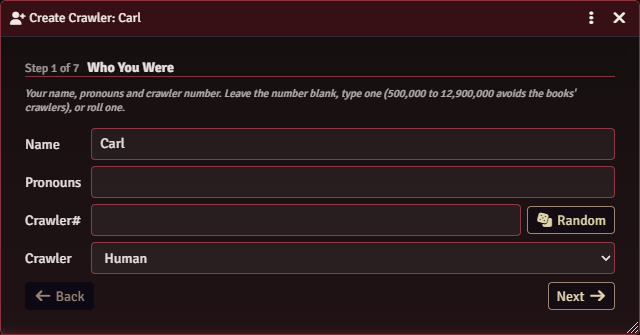
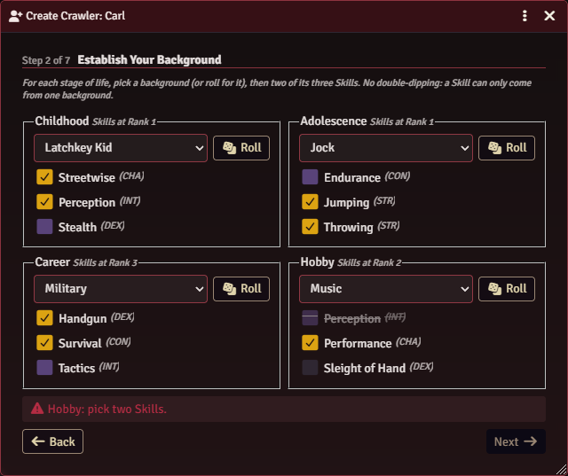
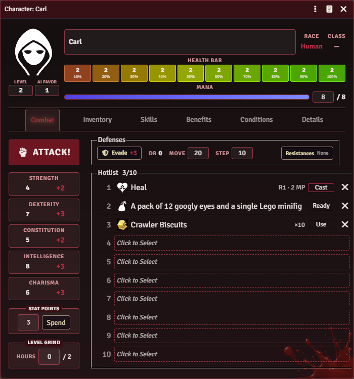

# Character Creation

Creating a new Character opens the **Create Crawler** wizard. It walks a player through making a First Floor crawler, step by step.

## The Steps

1. **Who You Were:** a human crawler or an animal crawler (if the GM allows animals).
2. **Establish Your Background:** pick or roll each stage of your life. Each one gives you Skills.
   - Humans: Childhood, Adolescence, Career and Hobby.
   - Animals: Youth, Training, Adult and Quirk.
3. **Choose Your Weapon:** your starting Attack.
   - An attack Spell needs Intelligence 4 or higher, and comes with 5 Mana Potions in one Hotlist slot.
   - Hand-to-hand also gives you its Damage Effect at Rank 3, and the GM owes you a Bronze Weapon Box.
4. **Choose Stats:** the Standard Array (place 2, 3, 4, 5 and 6), or roll 1d6 for each Stat in order, rerolling 1s. The GM's settings decide which you can use.
5. **Past Traumas, Loose Ends, and Regrets:** pick from the tables, roll, or write your own. These tell your GM what stories you want to tell.
6. **Starting Stuff:** whatever was on you when the collapse happened. Pick an example set or write your own.
7. **Review:** check everything, then create the crawler. Every crawler also gets Heal at Rank 1.

Good to know:

- Your GM can change which Stat and background methods are allowed in the system's settings.
- The GM can swap in their own background and past tables. See [Using Your Own Tables](#using-your-own-tables) below.
- The wizard makes First Floor crawlers only. Making a crawler for the Third to Fifth Floor is done by hand for now.

## Using Your Own Tables

The GM can replace the wizard's tables with their own. Make a table with exactly the same name, in your world or in a world compendium, and the wizard uses yours instead of the system's.

- **Backgrounds:** `Childhood Background Skills`, `Adolescence Background Skills`, `Career Skills` and `Hobby Skills`.
- **Animal backgrounds:** `Animal Youth Skills`, `Animal Training Skills`, `Animal Adult Skills` and `Animal Quirk Skills`.
- **The past:** `Past Traumas`, `Loose Ends` and `Regrets`.

Good to know:

- Keep each background row in the same shape as the system's, naming the three Skills it offers, so the wizard can read them.
- The CrawlerForge import always checks a crawler's past against the system's own tables, not yours.

## The Character Sheet

Once your crawler is made, everything about them is on their sheet: Level, Health Bar and Mana up top, and tabs for Combat, Inventory, Skills, Benefits, Conditions and Details. The Combat tab has the **Attack!** button, your Stats, your Defenses and your Hotlist.

## Races and Classes

Races and Classes come later, on the Third Floor. Drag one from the **Classes and Races** compendium onto the character sheet.

- Its Stat and Skill bonuses are added for you.
- Adding a Race sets your Size.
- Replacing your Race or Class makes the new one active.

### Races That Change With Day and Night

A few Races change depending on whether it's day or night. The GM sets which it is with the sun/moon toggle in the [GM Toolbox](GM-Toolbox).

- **Lajabless** (p.136):
  - By day: +5 Intelligence and half Strength, and Spells cost half the Mana.
  - By night: +5 Strength, then double Strength, and Spells cost double the Mana.
  - Mana costs round up and never drop below 1. The sheet, the Hotlist and the roll dialog all show the cost you'll actually pay.
  - This is handled via some bespoke code, so renaming the Race will break it.
- **Night Elves** (p.134) roll Hide in Shadows with Advantage at night.

## Importing a Crawler

Characters made on CrawlerForge can be brought in instead. See [Importing](Importing#importing-from-crawlerforge).
