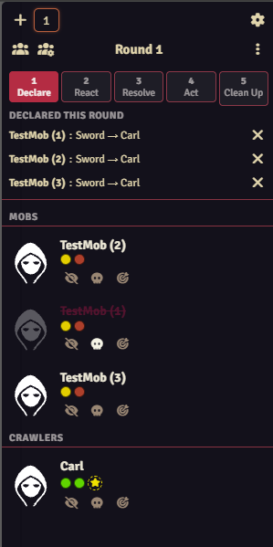
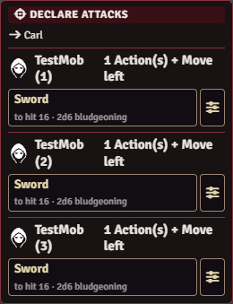
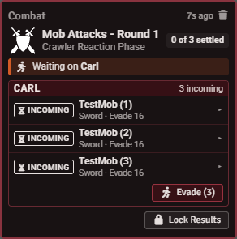
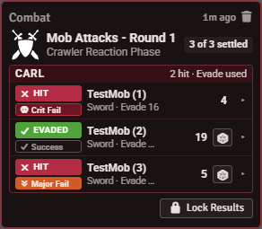
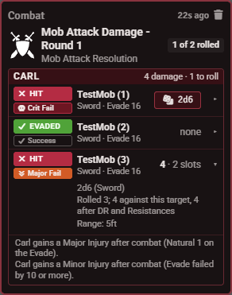
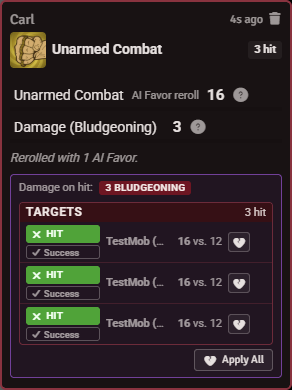
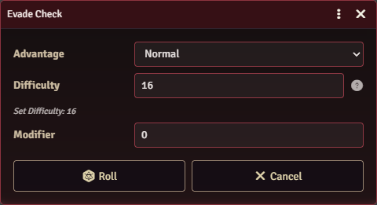

# Combat

Fights against Mobs run in the book's phases (pp.80-82). The GM moves the fight from one phase to the next from the Combat Tracker.

You can turn phased combat off in the system's settings. Combat then uses Foundry's normal turns, and Mob Attacks resolve as soon as they're rolled. Fights between crawlers only always use initiative.

## The Phases

Each round goes through these phases, in order. The tracker shows which one you're in, and the GM's button moves to the next.

1. **Surprise Round** (optional): if the crawlers surprised their foes, each crawler gets one free Action before the Mobs act.
2. **Mob Action Declaration:** the GM declares what each Mob is doing: its movement, its Attacks and their targets.
3. **Crawler Reaction Phase:** crawlers answer the declared Attacks: Evade, Taunt, Shield Block, Catcher, Heal or Intervene.
4. **Mob Attack Resolution:** the Mobs' Attacks land on everyone who didn't avoid them.
5. **Crawler Action Phase:** crawlers spend their remaining Actions, in any order.

## Actions

Each combatant's Actions show as bubbles in the Combat Tracker. They're spent automatically when you do something that costs one.

- Click a spent bubble to undo what it did.
- The GM can adjust anyone's Actions from the tracker's right-click menu.
- The AI Favor Action has its own bubble.

## Declaring Mob Attacks (GM)

During Declaration, selecting a Mob's token opens the **Declare Attacks** panel in the bottom right of the screen.

1. Select the Mob.
2. Target the crawlers it's attacking (the `T` key, or double-right-click).
3. Click one of its Attacks. It's declared against your targets right away, with no modifiers.

Good to know:

- The sliders button next to each Attack (**Modify Roll**) opens the Mob Attack dialog first, so you can change the to-hit or untick a Debuff.
- **Area Attacks always open the dialog,** so you can pick which crawlers only take Splash damage.
- Declared Attacks are listed under the Mob. The X withdraws one.

## Reacting: the Reaction Card

When the Reaction phase starts, every crawler's incoming Attacks show up together on one **Reaction card** in chat.

- **Evade:** one Evade Action covers every Attack aimed at you that round. You make a separate Check against each one, from a single dialog.
- **Shield Block** (p.198): works the same way, one Action for every Attack you can block.
- **Taunt:** pull a Mob's Attack onto yourself.
- **Intervene** (p.82): another crawler adds +1d6 to someone's roll with one click.

Once a crawler reacts, their section of the card shows each Attack's result: whether it hit or was evaded, and its Degree. The card counts how many Attacks are settled. When everyone's done, the GM clicks **Lock Results** to end the Reaction phase.

## Resolving: the Damage Card

Once Reaction ends, the GM rolls each Mob Attack once on the **Damage card**. Area, Splash, Major Fail and Natural 1 damage are all worked out for you.

## Making Attacks

Crawlers attack from the **Attack!** button on the Combat tab of their sheet, or from a Skill, Spell or Hotlist slot.

1. Target the Mobs you're attacking.
2. Make the Attack. The chat card gets one row per target, each with its own hit or miss.
3. Apply the damage from each row.

## The Roll Dialog in Combat

For an Attack, Evade or Shield Block, the dialog shows the Difficulty the rules give it, but you can't change it.

- Use the **Modifier** field for anything situational instead.
- When one roll covers several Attacks or targets, the Modifier applies to every one of them.
- With no target (and so no Difficulty), the Difficulty field stays open to type in.

## Degrees of Success

Every row on an Attack, Reaction or Damage card shows its Degree as a tag under its status: Amazing, Success, Near Miss, Fail, Major Fail, Crit Fail or Crit Hit.

- Hover over the tag to see what that Degree does.
- A Major or Critical Fail Evade shows even if a Shield Block worked, since that's the roll that decides the damage.
- An Area Attack's rows all show the shared roll.

## Damage

Damage goes through DR, Resistances, Vulnerabilities and Immunities, then comes off in whole Health Bar slots.

- **Shields** are a second pool that soaks up non-magical damage first.
- **Armor-Piercing** damage ignores DR, except from Anti-Piercing gear (p.95, p.225).
- The GM sees a **Damage Applied** note on the card, with the math for each target and the slots lost.

## Debuffs

Debuffs apply their own penalties, change Mob Difficulties, and wear off on their own when their time is up.

- A weapon, Skill or Spell can inflict Debuffs on a hit, or only on a Critical Hit or an Amazing Success.
- A Mob's Debuffs land by their trigger: on a hit, on a bad Evade, or on a Critical Fail.

## Rerolls

Crawler Checks get a **Reroll (AI Favor)** button (p.61). It spends 1 AI Favor and rerolls the d20, keeping all modifiers.

- Once per Check.
- Never on a Natural 1.
- Not once the result has been used.
