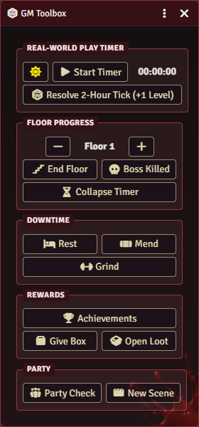

# GM Toolbox

The GM Toolbox is where most of the GM's actions live. Open it from the tool in the Token Controls on the left of the screen. Only the GM can see it.

## Real-World Play Timer

- **Day/night toggle:** The sun or moon button sets whether it's day or night in the dungeon. Click it to switch. Lajabless, Night Elves, and Gobblin' Hogs receive appropriate changes.
  - Entirely manual; it isn't automatically set by the clock, since the book doesn't say how long a dungeon night lasts and homebrew floors might differ.
- **Start Timer:** A real-world timer for your session. At 2 hours, you get a reminder to level up Crawlers.
- **Resolve 2-Hour Tick (+1 Level):** Pick who's eligible. Each gains 1 Level, and their marked Skills at Rank 4 or lower roll Advancement Checks.

## Floor Progress

- **Floor + and -:** Change the current Floor. This will prompt you to start the floor timer for the new floor.
- **End Floor:** For everyone descending, marked Skills at Rank 5+ roll Advancement Checks, all marks are erased, and Popularity changes by Charisma.
- **Boss Killed:** Awards Levels for a Boss kill by its tier (p.170), and a Boss Box (p.22).
- **Collapse Timer:** Set the time until this floor collapses, or stop it. Useful for the first floor or if you skipped starting the timer when changing floors.

### The Floor Collapse Timer

Everyone sees the Floor and the time left before it collapses (pp.62-63), on a bar just above the hotbar.

- It counts down in 30-hour dungeon days.
- It follows Foundry's in-world clock, so rests, grinding and combat move it. It works with calendar modules too.
- It turns amber in the last 30 hours and red in the last 24.
- Each floor keeps an independent timer, so a misclick can be fixed without losing the old timer.

## Downtime

- **Rest:** A Short Rest (2 hours), Long Rest (8 hours) or Full Day's Rest (30 hours), for only the characters you choose. Each shows the book's text for that rest (p.94), and moves the clock forward.
- **Mend:** Each full hour outside combat or stress gives +1 Health Bar slot and +5 Mana (p.95).
- **Grind:** Log hours of grinding a Skill. Once enough hours build up, it rolls an Advancement Check. Players will be prompted to apply surplus hours to a new skill. Applies 1d2 levels to the lowest level Crawler, unless there is a tie.

## Rewards

- **Achievements:** Make, edit and award achievements. See [Loot Boxes and Achievements](Loot-Boxes-and-Achievements).
- **Give Box:** Give crawlers an unopened loot box. Useful for miscellaneous random loot, if you missed a box, or you just feel like being a benevolent ~~god~~ AI.
- **Open Loot:** The party opens its unopened loot boxes together, one crawler at a time, so you can make an event out of it.

## Party

- **Party Check:** A Party Skill Check (p.59). Prompts for the skill, everyone rolls; if half or more succeed, the party succeeds.
- **New Scene:** Every "Once per scene" cooldown ends, for every actor in the world.
