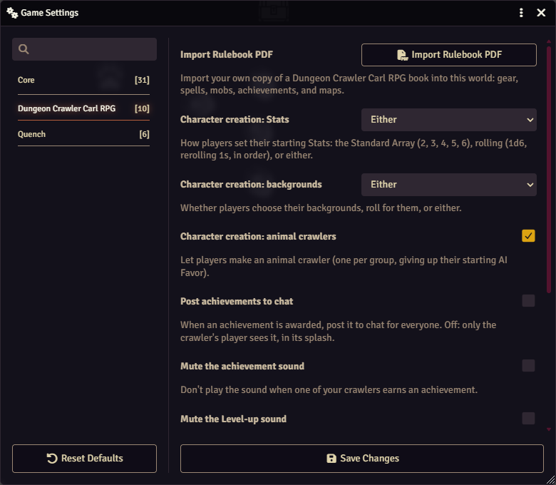

# Getting Started

Install the system, make a world, and set a few options before your first session.

## Installing

In Foundry's **Game Systems** tab, choose **Install System** and paste this manifest URL:

```
https://github.com/SobranDM/carl-rpg/releases/latest/download/system.json
```

- Requires **Foundry VTT v14**.
- Updates show up in the same tab, like any other system.

## Your First World

1. Create a world using the **Dungeon Crawler Carl RPG** system.
2. If you own the rulebook PDFs, import them. See [Importing](Importing).
3. Have your players make their crawlers. Creating a new Character opens the Create Crawler wizard. See [Character Creation](Character-Creation).

## World Settings

These are in **Game Settings → Configure Settings → Dungeon Crawler Carl RPG**.

- **Phased combat:** runs fights against Mobs in the book's phases (Declaration, Reaction, Resolution, Crawler Actions). On by default.
  - Turn it off to use Foundry's normal turns instead. Mob Attacks then resolve as soon as they're rolled.
  - Fights between crawlers always use initiative either way.
- **Character creation: Stats:** the Standard Array (2, 3, 4, 5, 6), rolling (1d6 in order, rerolling 1s), or let players pick.
- **Character creation: backgrounds:** choosing, rolling, or either.
- **Character creation: animal crawlers:** whether players can make an animal crawler.
- **Post achievements to chat:** off by default, so only the crawler's player sees the achievement splash.
- **Show AI Text on Token Hover:** shows a Mob's AI Text beside its token when anyone hovers over it.

Each player also has their own settings to mute the achievement, Level-up and loot box sounds.



## Where Things Are

- **The GM Toolbox** is a tool in the Token Controls on the left of the screen (GM only). See [GM Toolbox](GM-Toolbox).
- **The floor collapse timer** is the bar just above the hotbar. Each player can drag it somewhere else.
- **The compendiums** (Skills and Spells, Classes and Races, Gear, Consumables, Roll Tables) are in the Compendium sidebar.
- **Import Rulebook PDF** is in the system's settings, and also in the Items sidebar (GM only).
- **Import CrawlerForge** is a button in the Actors sidebar.
