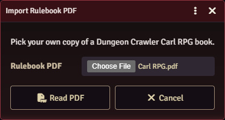

# Importing

The system doesn't ship any rulebook text or art. If you own the PDFs, you can pull their content into your world. Characters made on CrawlerForge can be brought in too.

## Importing a Rulebook PDF

A GM can import a book from the system's settings, under **Import Rulebook PDF**. The same button is in the Items sidebar.

What you get:

- **Gear and Spells.** Where this system's compendiums already have the item, that copy is used.
- **Mobs,** with their Attacks, Debuffs and AI Text, filed by Floor and then by Neighborhood or Quest.
- **Achievements,** into the Achievements compendium, in a folder per book.
- **Maps** as gridless Scenes. Pick which maps you want, or none. Map images are saved to `carl-rpg/<book>/maps/` in your Foundry Data folder.

Good to know:

- Each book gets its own GM-only compendiums.
- Importing a book again (such as after a feature update) updates items and actors you haven't edited, but leaves changed documents as they are.
- Both the core rulebook and the Gamemaster's Toolkit are supported.
- The low-quality (LQ) edition of the PDF is **NOT** supported. The importer will reject it.

## Importing From CrawlerForge

Use the **Import CrawlerForge** button in the Actors sidebar and pick a CrawlerForge export.

- Skills, Spells, and gear are copied from this system's compendiums when names match.
- Skills and Spells CrawlerForge invented come in marked "Not in rulebook" to avoid confusion.
- Gear is put on the Equipment Doll where possible.
- The GM gets a report of anything that didn't match.

## Using Your Own Tables

Many of the system's Roll Tables can be replaced with your own copy:

- **Loot box and magic item tables.** See [Loot Boxes and Achievements](Loot-Boxes-and-Achievements#using-your-own-tables).
- **Character creation tables.** See [Character Creation](Character-Creation#using-your-own-tables).

The Boons table can't be replaced.
