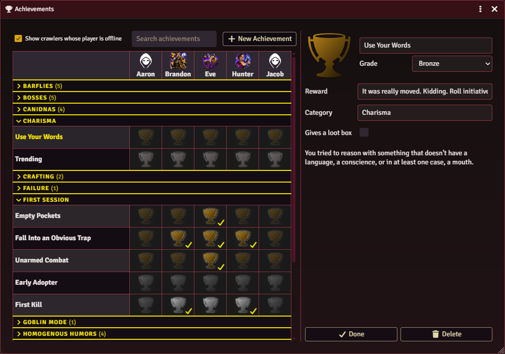
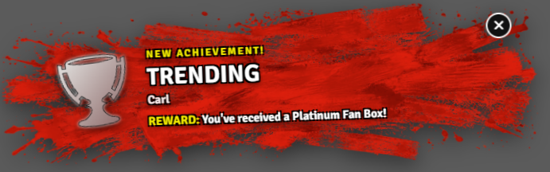
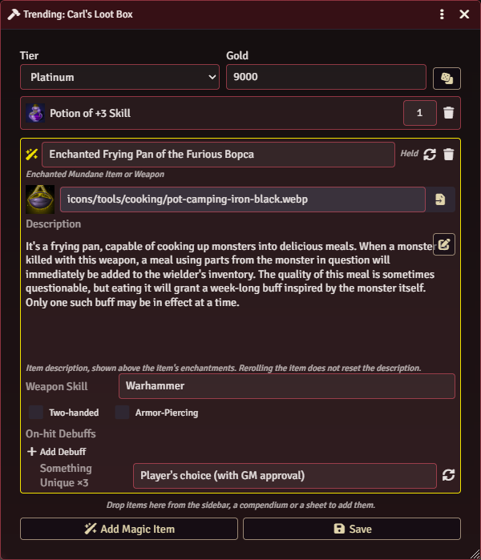
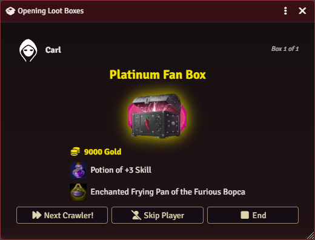

# Loot Boxes and Achievements

Achievements and loot boxes work together. Awarding an achievement can give the crawler a loot box, and the party opens its boxes together, with everyone watching.

## Achievements

The GM makes, edits and awards achievements in the **Achievements** window, opened from the [GM Toolbox](GM-Toolbox).

Each achievement has:

- a description
- a **Reward** (for example "You've received a Bronze Crafter's Box!")
- a grade, Bronze to Celestial, which sets its icon
- an option to give a loot box
- an optional **Category**, to group it with others in the window

Good to know:

- The list is on the left and the editor on the right. Click a category's name to fold it, and use the search box to find one by name or category.
- Achievements are kept in an Achievements compendium the system looks after. The [rulebook import](Importing) puts the book's achievements there too.
- GM Secrets in an achievement's description stay hidden from players.

### Awarding

Award an achievement to a crawler from the Achievements window.

- The crawler's player gets a **New Achievement!** splash, which stays until they close it, even if they were offline when it was awarded.
- A world setting can also post it to chat for everyone (off by default).
- A Character's Details tab lists their achievements.

## Loot Boxes

Loot boxes live in the crawler's Inventory, behind a **Show Loot Boxes** button (p.21).

- They come from achievements, Boss kills (p.22), or the GM's **Give Box** in the Toolbox.
- Players see a box's art and title, never what's inside.
- Players can't change or delete their boxes.

### What's Inside

A box holds what the book describes: one headline item, a consumable or two, and gold.

- **Bronze:** a mundane item, swapped for a weak magic item about a third of the time.
- **Silver and up:** a magic item, with bonuses in its tier's range.
- **Gold** for the crawler who opens it.
- Magic items get real bonuses, to a Skill the crawler actually has.

### Themed Boxes

A box's theme comes from its name: "Bronze Goblin Box" is a Goblin box. For an achievement's box, that's the name in its Reward field.

Themes with their own tables so far: Goblin, Pet, Crafter's, Mechanic's, Survivor's, Lucky Bastard and Weapon.

- A Goblin box gives explosives and things to go with them. A Pet box gives pet supplies, and so on.
- Any other theme, or no theme, uses the normal tables for its tier.
- Themed mundane items only matter for Bronze boxes, since Silver and up don't give a mundane item.
- **Weapon boxes** are the exception. From Silver up, the magic item is a weapon drawn from the Weapon Box table, with its enchantments rolled on the Enchanted Mundane Item or Weapon table.

### Preparing a Box Ahead of Time (GM)

The GM can decide what's in a box before it's opened, or leave it to be rolled when it's opened.

- Prepare a crawler's box from its sheet, or by right-clicking the trophy from the Achievements window, before or after the achievement is awarded, provided the box hasn't yet been opened.
- The **Loot Forge** is where you set the gold, quantities, and each magic item's name, slot, bonuses, image and description. A weapon also takes Two-Handed, Armor-Piercing and on-hit Debuffs.
- Closing the Forge saves your changes, the same as **Save**. If you didn't change anything, closing it leaves the box as it was.
- **Roll When Opened** throws away what you prepared, so it's rolled instead. It asks first.

### Opening Boxes Together

The GM starts a session with **Open Loot** in the Toolbox. Everyone watches, one crawler at a time.

- Each box shakes, glows and shows what you won. All of the loot goes straight onto the sheet.
- Only that crawler's player or the GM can move on to the next box.
- The GM can skip a player to avoid holding things up, in case a player stepped away.

## Using Your Own Tables

You can change what boxes hold by making your own copy of a box table, with exactly the same name. The system uses yours instead of its own. The easiest way is to import the system's table from the **Roll Tables** compendium and edit your copy.

- **Your copy can live** in your world or in a world compendium. If both have one, the one in your world wins. If several world compendiums have one, the first compendium the world lists wins. This is decided by Foundry in the order they were made, not the sidebar's order, so try to avoid this.
- Each box draws from up to three tables: **Mundane** (Bronze only), **Weak Magic** (Bronze only, about a third of the time instead of the mundane item) and **Consumables** (every tier).

### The Tables

The system ships these:

- **For every box of a tier:** `Bronze Box: Mundane`, `Bronze Box: Weak Magic`, and `<Tier> Box: Consumables` for Bronze, Silver, Gold, Platinum, Legendary and Celestial.
- **For themed boxes:** `Goblin Box`, `Pet Box`, `Crafter's Box`, `Mechanic's Box`, `Survivor's Box` and `Lucky Bastard Box`, each with a `: Mundane` and a `: Consumables` table, plus `Weapon Box: Mundane`.

### Which Table a Box Uses

For each draw, the system tries these names in order and uses the first one it finds:

1. `<Tier> <Theme> Box: <Kind>`, for example "Gold Crafter's Box: Consumables"
2. `<Theme> Box: <Kind>`, for example "Crafter's Box: Consumables"
3. `<Tier> Box: <Kind>`, for example "Gold Box: Consumables"

Good to know:

- At each step, your copy of the table in the world or a world compendium takes priority over the system's table. But a more specific name always wins first, so a themed box uses the system's themed table even if you've edited the plain tier table. To change what a Goblin box holds, import and change "Goblin Box: Mundane" and "Goblin Box: Consumables".
- "Crafter Box" and "Crafter's Box" are treated the same.
- **To add a new theme,** just make a table for it, such as "Adventurer Box: Consumables". Any box with that theme starts using it.
- **To make one tier's themed box different,** use the first form, such as "Gold Pet Box: Consumables".
- Only Bronze boxes draw a mundane item, so a Mundane table for Silver and up is never used.

### Table Rows

- **A text row** becomes a simple item with that name. "Torch ×10" gives 10 Torches, and the row's description becomes the item's.
- **A row linked to an item** (from the Gear or Consumables compendium, or your own) gives a copy of that item. Use this for anything with stats, like weapons.

### Magic Item Tables

The magic item tables are the book's own. A copy in your world replaces them, but a copy in a world compendium doesn't.

- `Item Type`
- `Enchanted Accessory (Jewel, Belt, Patch, Tattoo, etc.)`
- `Enchanted Clothing`
- `Enchanted Mundane Item or Weapon`
- `Something Unique`
- `Random Spells`, used for scrolls and spellbooks
